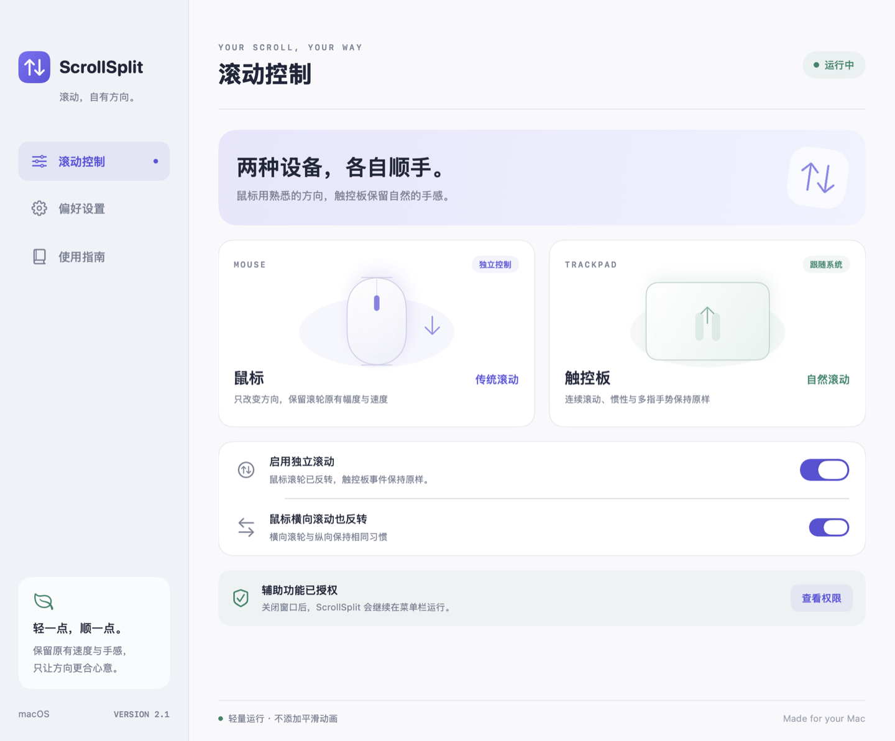

<div align="center">


# ScrollSplit

### 两种设备，各自顺手。

鼠标用熟悉的方向，触控板保留自然的手感。<br>
一个轻量的 macOS 菜单栏应用，让滚动方向分开设置。

<p>
  <code>macOS 13+</code>&nbsp;
  <code>Apple 芯片 / Intel</code>&nbsp;
  <code>SwiftUI</code>&nbsp;
  <code>v2.1.0</code>
</p>

**[↓ 下载 macOS 安装包](https://github.com/JiachengLuo666/ScrollSplit/releases/latest)**&nbsp; · &nbsp;[安装指南](#安装与升级)&nbsp; · &nbsp;[更新记录](CHANGELOG.md)

<br>



<sub>原生应用界面预览 · 图中运行及授权状态为预览数据，实际以本机状态为准。</sub>

</div>

<br>

## 让方向适应习惯

macOS 的鼠标与触控板“自然滚动”设置会相互影响。ScrollSplit 在系统自然滚动开启的基础上，单独反转普通鼠标的滚轮方向。

| 设备 | 使用体验 |
| :--- | :--- |
| **鼠标** | 传统滚动方向；可选择同时反转横向滚轮。 |
| **触控板** | 保留系统自然滚动，连续滚动与惯性事件保持原样。 |

只改变鼠标滚轮方向，保留原有滚动幅度与速度。无需联网，不添加额外平滑动画。

## 小工具，也要顺手

| | |
| :--- | :--- |
| **方向分开设置**<br>鼠标独立反转，横向滚动可单独开关。 | **状态抬眼可见**<br>菜单栏显示运行、暂停、待授权等状态。 |
| **原生设置界面**<br>滚动控制、偏好设置与使用指南集中管理。 | **随时暂停恢复**<br>通过界面或菜单栏切换，退出即恢复系统行为。 |
| **启动按你习惯**<br>支持登录启动，也可选择登录时是否显示窗口。 | **遇到问题有入口**<br>直达权限设置、重新连接服务，内置滚动试用区域。 |

关闭窗口后继续在菜单栏运行，再次打开应用即可回到设置。窗口仅顶部标题栏可以拖动。

## 安装与升级

1. **下载并安装**<br>
   从 [Releases](https://github.com/JiachengLuo666/ScrollSplit/releases/latest) 下载 DMG，将 **ScrollSplit** 拖入 **Applications**。升级时先退出旧版，再选择“替换”。

2. **打开安装后的应用**<br>
   复制完成后，双击安装包里的“打开已安装版本”，或从“应用程序”打开 ScrollSplit。拖拽复制本身不会自动启动应用。

3. **开启系统自然滚动**<br>
   在 macOS 的触控板设置中保持“自然滚动”开启，让触控板继续按原有方式工作。

4. **允许辅助功能权限**<br>
   点击应用中的“去授权”，在 **系统设置 → 隐私与安全性 → 辅助功能** 中允许 ScrollSplit。菜单栏显示“运行中”后，就可以试试手感。

> [!IMPORTANT]
> 当前安装包使用临时签名，尚未进行 Apple 公证。若首次打开被系统拦截，可在“隐私与安全性”中选择“仍要打开”。建议先安装到“应用程序”再授权，避免移动应用后需要重新授权。

**覆盖升级会保留独立滚动和横向反转设置。** 当前提供手动下载安装包更新，尚未接入应用内自动更新。

<details>
<summary><strong>校验下载文件</strong></summary>

每个 2.1 Release 同时提供 `ScrollSplit-2.1.dmg` 和 `ScrollSplit-2.1.sha256`。将二者放在同一目录，在该目录的终端运行：

```bash
shasum -a 256 -c ScrollSplit-2.1.sha256
```

输出 `ScrollSplit-2.1.dmg: OK` 表示文件校验通过。

</details>

## 2.1，让打开更可靠

- **旧副本正常交接**：手动打开新版时，请求后台旧副本退出，确认退出后再启动新版滚动监听。
- **界面找得回来**：手动打开会显示控制面板，恢复隐藏、最小化或留在断开显示器上的窗口。
- **启动方式可选**：新增“登录启动时显示窗口”；首次安装或升级后首次启动也会显示界面。
- **安装位置更明确**：显示版本与安装位置，可直接在访达中定位当前应用。

[查看完整更新记录 →](CHANGELOG.md)

## 兼容范围

**推荐：普通滚轮鼠标 + Mac 触控板。**

设备区分依据是 macOS 的离散/连续滚动标志，以及滚动阶段、惯性标志，并非硬件设备 ID。以下情况可能无法正确分离：

- Magic Mouse、高精度连续滚动鼠标。
- 将鼠标滚轮模拟成触控板事件的第三方驱动。
- 远程桌面、虚拟输入或其他工具修改过的滚动事件。

如正在使用 Mos、Scroll Reverser、LinearMouse 等工具，请先暂停其中的滚动接管功能，避免方向叠加。实际手感与驱动兼容性仍需在自己的设备上确认。

## 常见问题

<details>
<summary><strong>已经授权，为什么仍显示“待授权”？</strong></summary>

升级、移动应用或重新编译后，macOS 可能不再认可旧条目。请在“辅助功能”中移除旧版条目，再添加“应用程序”里的新版。

授权后状态通常约 2 秒内更新。若仍未生效，可在偏好设置中点击“重新连接”，或退出后再打开。

</details>

<details>
<summary><strong>打开后没看到窗口，该怎么办？</strong></summary>

点击菜单栏里的 ScrollSplit 状态，选择“打开 ScrollSplit…”。

2.1 已加入隐藏/最小化恢复、多屏位置恢复和旧进程交接。如果旧版本无法正常退出，新版会提示先退出旧版；随后从“应用程序”重新打开即可。

</details>

<details>
<summary><strong>会影响触控板手势或滚动速度吗？</strong></summary>

ScrollSplit 只监听滚轮事件，对选中的鼠标事件反转增量符号，不重发事件、不插入动画，不改时间戳、修饰键或指针速度。连续滚动、滚动阶段及惯性事件原样通过。

这能保留常规触控板的滚动行为，但无法保证所有第三方驱动的事件形式一致。兼容边界见上文。

</details>

<details>
<summary><strong>如何暂停、退出和卸载？</strong></summary>

在菜单栏选择暂停，或关闭界面中的“启用独立滚动”。关闭窗口会继续在菜单栏运行；选择“退出 ScrollSplit”才会结束应用并恢复系统原有滚动。

卸载前关闭“登录时自动启动”，再退出应用、移到废纸篓，并从辅助功能列表移除它。应用没有额外的后台守护进程。

</details>

## 开发与验证

应用使用 **Swift、SwiftUI、AppKit 与 CoreGraphics**，运行时无需第三方依赖。

<details>
<summary><strong>从源码构建与打包</strong></summary>

准备 macOS 13+ 与 Apple Command Line Tools。在仓库目录中运行：

```bash
# 构建 Apple 芯片与 Intel 通用版
bash ./build.command

# 打包 DMG
bash ./package.command
```

默认在仓库的上一级目录生成 `ScrollSplit.app` 与对应版本的 DMG。构建前退出目标路径中的应用。

`build.command` 支持传入目标 `.app` 完整路径；`package.command` 支持传入待打包 `.app` 路径。

DMG 打包需要 Python 3 和网络：脚本在临时虚拟环境中安装 `dmgbuild==1.6.5`，完成后清理临时环境。最终应用没有 Python 依赖。

重新编译会改变临时签名，macOS 可能要求重新添加辅助功能授权。

</details>

<details>
<summary><strong>测试与代码结构</strong></summary>

```bash
bash ./test.command
bash ./test-ui.command

# 先构建应用，再运行真实应用包的启动与升级测试
bash ./build.command
bash ./test-launch.command
```

`test-launch.command` 也支持传入待测试 `.app` 的完整路径。UI 与启动测试需要可用的 macOS 图形会话。

**2.1 发布前的本机验证：54 项检查通过。**

| 检查 | 数量 | 主要覆盖 |
| :--- | ---: | :--- |
| 逻辑测试 | 28 | 鼠标增量、触控板/惯性保护、状态判断与多屏位置 |
| 窗口与设置测试 | 19 | 关闭、隐藏、最小化后恢复，菜单操作与偏好迁移 |
| 应用包启动测试 | 7 | 旧进程退出、新版窗口显示与单实例运行 |

打包流程还会检查应用签名、包内可执行文件一致性与安装快捷入口。测试不替代真实设备手感、登录项和第三方驱动验证。

| 文件 | 职责 |
| :--- | :--- |
| [ScrollFilter.swift](Sources/ScrollFilter.swift) | 筛选滚轮事件、反转方向 |
| [ScrollEngine.swift](Sources/ScrollEngine.swift) | 监听、暂停与恢复滚动服务 |
| [AppModel.swift](Sources/AppModel.swift) | 共享设置、权限和运行状态 |
| [App.swift](Sources/App.swift) | 菜单栏、窗口与启动交接 |
| [MainView.swift](Sources/MainView.swift) | 原生设置界面 |
| [Tools](Tools/) | 图标、预览与 DMG 打包工具 |

UI 检查使用独立预览模型；启动集成测试使用隔离的应用标识，不接管当前运行的 ScrollSplit，也不授予辅助功能权限。

</details>

---

<div align="center">

**ScrollSplit · 滚动，自有方向。**

[下载安装](https://github.com/JiachengLuo666/ScrollSplit/releases/latest)&nbsp; · &nbsp;[反馈问题](https://github.com/JiachengLuo666/ScrollSplit/issues)&nbsp; · &nbsp;[更新记录](CHANGELOG.md)

</div>
